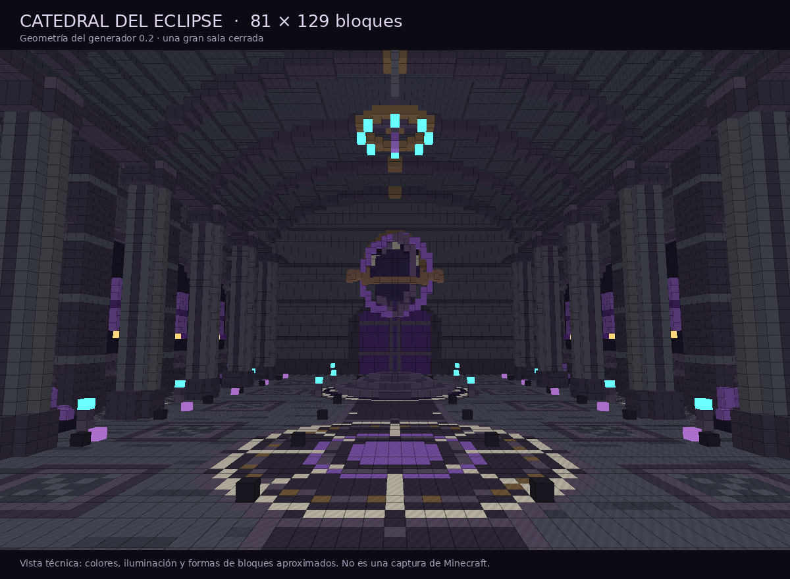

# CosmicArchitect IA — 0.2.0

Constructor de arquitectura cósmica para **Paper 1.21.11 / Java 21**, con planos YAML que puedes preparar en ChatGPT. La transferencia del plano es manual: no usa API, credenciales ni consultas de pago.

## Descargar la nueva versión

- **[Descargar CosmicArchitect-0.2.0.jar](https://raw.githubusercontent.com/SrChoringon/cosmicarchitect-ia/main/downloads/CosmicArchitect-0.2.0.jar)** — plugin para `plugins/`.
- **[Descargar paquete ZIP 0.2.0](https://raw.githubusercontent.com/SrChoringon/cosmicarchitect-ia/main/downloads/CosmicArchitect-0.2.0.zip)** — plugin, instrucciones, plano y código.

## Actualizar y probar la gran sala

1. Detén el servidor. **Retira el JAR 0.1.0 de `plugins/`** y coloca el JAR 0.2.0. Debe quedar un solo JAR de CosmicArchitect.
2. Conserva `plugins/CosmicArchitect/`: la actualización instala el plano nuevo sin sobrescribir los existentes.
3. Arranca y ejecuta como OP:

```text
/cosmic check catedral
/cosmic build catedral
/cosmic status
```

4. Al terminar, copia el comando `/cosmic visit cosmic_...` que mostrará.
5. Regresa con `/cosmic leave`. Guarda y descarga un mundo vacío de memoria con `/cosmic unload <mundo>`.

Si el límite de dos mundos propios está ocupado por pruebas anteriores, sal de ellas y usa `unload` antes de generar la catedral. La actualización no transforma ni borra construcciones anteriores.

## Catedral del Eclipse

Una gran sala **cerrada y opaca**, de **81 × 129 bloques**, con bóveda de hasta **48 bloques sobre el suelo**. La cubierta tiene dos capas; no es una cúpula de cristal.

- Nave central amplia con columnas agrupadas, capiteles, nervaduras y cornisas.
- Capillas laterales con bibliotecas, estatuas y pequeños grupos de cristales.
- Puerta monumental cerrada y rosetones de piedra como relieves.
- Altar escalonado con escaleras orientadas, mosaico estelar y esfera eclipsada suspendida entre anillos.
- Lámparas suspendidas, velas y luz de suelo cubierta por alfombras negras. El cristal queda limitado a pequeños detalles de pared.



La imagen deriva de los bloques que produce el generador. La luz real, las texturas y los bloques parciales se verán distintos dentro de Minecraft.

## Crear otro plano con ChatGPT

Usa [PROMPT-CHATGPT.md](PROMPT-CHATGPT.md), guarda el YAML en `plugins/CosmicArchitect/plans/<nombre>.yml` y ejecuta `check` y `build` con ese nombre, sin extensión.

El nuevo tipo `cathedral` admite una sola sala por plano, radio 32..48 (ancho 65..97 y largo 113..145), altura 36..52 y las paletas `void`, `nebula` o `eclipse`. El texto del nombre no genera formas nuevas: la arquitectura cambia según los campos admitidos. Los cinco tipos antiguos siguen disponibles para compatibilidad, con sus tamaños anteriores.

## Validación y límites

La versión se compiló y se construyó en Paper 1.21.11 con MythicDungeons 2.1.0 instalado. Se verificaron las 96 652 posiciones y estados de bloque de la catedral, además de su punto de entrada y liberación de tickets de chunks. Las pruebas de geometría comprueban suelo, cubierta y muros cerrados, pasillo libre, límites y escaleras.

Todavía es un **constructor de escenarios**: no registra partidas, enemigos, objetivos ni recompensas en MythicDungeons y no modifica su JAR. No se ha hecho una inspección con un cliente Minecraft de esta versión ni se ha medido su carga en Vultam.

La geometría se calcula fuera del hilo principal y la colocación se reparte por tandas, con chunks cargados asíncronamente. Los límites por tick y de mundos no garantizan cero lag.

- [Guía de uso](LEEME.md)
- [Pruebas y limitaciones](PRUEBAS.md)

## Compilar

Con Python 3, Java 21 y conexión HTTPS a Maven Central y al repositorio de Paper:

```sh
python3 build.py
```

El script descarga dependencias de compilación fijadas, ejecuta las pruebas y genera `build/CosmicArchitect-0.2.0.jar`. El JAR original de MythicDungeons no se redistribuye.
