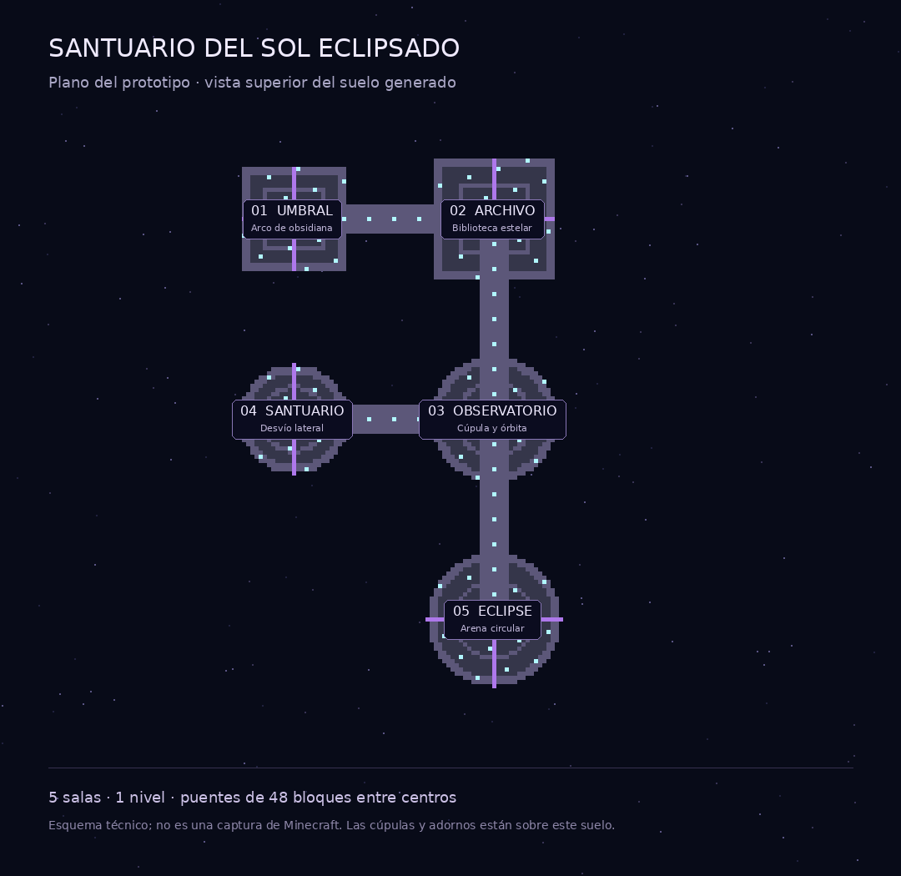

# CosmicArchitect IA

Prototipo de arquitectura cósmica para **Paper 1.21.11 y Java 21**, construido desde planos YAML que puedes crear con ChatGPT. No requiere API, claves ni consultas de pago. La transferencia del plano desde ChatGPT es manual.

## Descargar e instalar

- **[Descargar el plugin JAR](https://github.com/SrChoringon/cosmicarchitect-ia/releases/download/v0.1.0/CosmicArchitect-0.1.0.jar)** — archivo para subir a `plugins/`.
- **[Descargar el paquete ZIP](https://github.com/SrChoringon/cosmicarchitect-ia/releases/download/v0.1.0/CosmicArchitect-0.1.0.zip)** — JAR, instrucciones en español, plano de ejemplo, pruebas y código.
- [Ver la versión y sus archivos](https://github.com/SrChoringon/cosmicarchitect-ia/releases/tag/v0.1.0).

1. Detén tu servidor de pruebas y sube el **JAR** a `plugins/`.
2. Arranca Paper 1.21.11 con Java 21.
3. Como OP, ejecuta `/cosmic check eclipse` y `/cosmic build eclipse`.
4. Consulta `/cosmic status`; al terminar, copia el comando `/cosmic visit cosmic_...` que te mostrará.
5. Regresa con `/cosmic leave`. Para guardar y descargar de memoria una prueba vacía, usa `/cosmic unload <mundo>`.

No subas el ZIP a `plugins/`: utiliza el JAR que contiene.

## Qué construye

Cinco arquetipos procedurales de sala, tres paletas, cúpulas, órbitas de amatista, bibliotecas, arcos, altares y puentes iluminados sobre el vacío. Las salas se construyen desde cero, sin esquemas externos. Los planos permiten combinar los arquetipos dentro de límites definidos; no generan arquitectura arbitraria.



El ejemplo conecta un umbral, un archivo estelar, un observatorio, un santuario lateral y una arena. Las construcciones se crean en mundos nuevos.

## Nuevos planos y documentación

- [Guía de instalación, comandos y límites](LEEME.md).
- [Texto para pedir nuevos planos a ChatGPT](PROMPT-CHATGPT.md).
- [Pruebas realizadas y lo que falta validar](PRUEBAS.md).

Guarda los nuevos planos en `plugins/CosmicArchitect/plans/<nombre>.yml` y usa `/cosmic check <nombre>` antes de `/cosmic build <nombre>`.

## Alcance de esta versión

Este es un **prototipo de escenarios**. Convive con MythicDungeons 2.1.0 en la prueba de arranque, pero todavía **no registra dungeons jugables, enemigos, jefes, objetivos ni recompensas** en MythicDungeons. No modifica ni optimiza internamente su JAR. La inspección visual con un cliente Minecraft y el rendimiento bajo carga en el hosting siguen pendientes.

La geometría se calcula en segundo plano. La colocación usa tandas con presupuesto de tiempo y carga asíncrona de chunks; se permiten dos mundos propios cargados por defecto. Estos límites no garantizan cero lag ni una capacidad concreta con 7 GB.

## Compilar

Necesitas Python 3, Java 21 y acceso HTTPS a Maven Central y al repositorio de Paper:

```sh
python3 build.py
```

El script descarga el compilador ECJ y las dependencias de compilación fijadas, ejecuta 50 comprobaciones de geometría y genera `build/CosmicArchitect-0.1.0.jar`. Las dependencias no se incluyen en el plugin final. El JAR de MythicDungeons no se distribuye en este repositorio.
